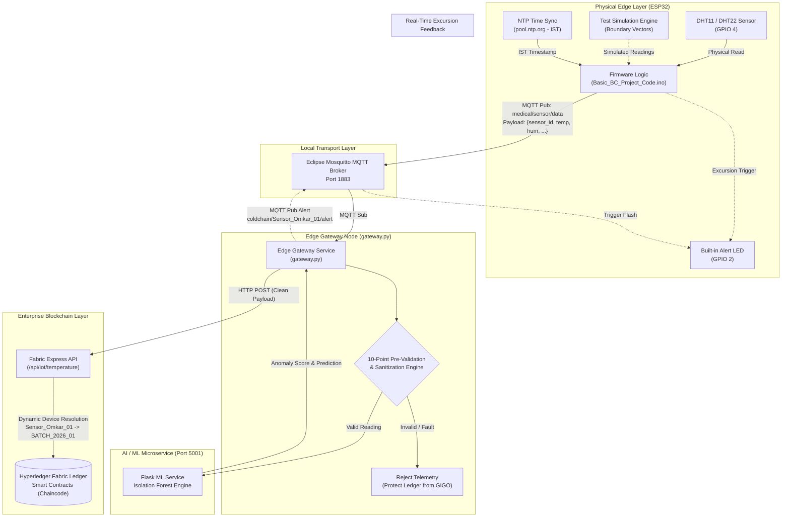
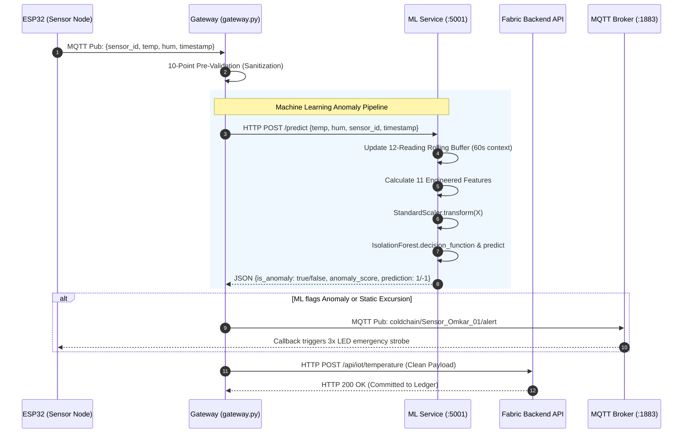

# ColdChainRx — IoT & Edge Security Subsystem

> **Decentralized Pharmaceutical Cold-Chain Monitoring Platform**  
> Fusing Physical IoT Telemetry, Edge Gateways, Machine Learning Anomaly Detection, and Hyperledger Fabric Blockchain.

---

## 📋 Table of Contents
- [Executive Overview](#-executive-overview)
- [Team Ownership & Role Scope](#-team-ownership--role-scope)
- [End-to-End System Architecture](#-end-to-end-system-architecture)
- [Hardware & IoT Firmware (`Basic_BC_Project_Code.ino`)](#-hardware--iot-firmware-basic_bc_project_codeino)
  - [1. Circuit Pinout & Hardware Architecture](#1-circuit-pinout--hardware-architecture)
  - [2. Dynamic Device Binding (Decoupling Sensor from Batch)](#2-dynamic-device-binding-decoupling-sensor-from-batch)
  - [3. Wi-Fi & MQTT Self-Healing Network Logic](#3-wi-fi--mqtt-self-healing-network-logic)
  - [4. NTP Clock Synchronization & Timestamping](#4-ntp-clock-synchronization--timestamping)
  - [5. Robust Sensor Acquisition & Fault Tolerance](#5-robust-sensor-acquisition--fault-tolerance)
  - [6. Bidirectional Excursion Alerts & LED Feedback](#6-bidirectional-excursion-alerts--led-feedback)
  - [7. Simulation Engine & Boundary Test Vectors](#7-simulation-engine--boundary-test-vectors)
- [Edge IoT Gateway Engine (`gateway.py`)](#-edge-iot-gateway-engine-gatewaypy)
  - [1. Role as the Trusted Edge Bridge](#1-role-as-the-trusted-edge-bridge)
  - [2. 10-Point Edge Validation & Sanitization Engine](#2-10-point-edge-validation--sanitization-engine)
  - [3. Machine Learning Microservice Pipeline](#3-machine-learning-microservice-pipeline)
  - [4. Blockchain Submission & Error Isolation](#4-blockchain-submission--error-isolation)
  - [5. Collision-Free MQTT Architecture](#5-collision-free-mqtt-architecture)
- [Role of the Machine Learning Model & How It Is Used](#-role-of-the-machine-learning-model--how-it-is-used)
  - [1. Why Static Thresholds Alone Are Insufficient](#1-why-static-thresholds-alone-are-insufficient)
  - [2. Isolation Forest Anomaly Detection Algorithm](#2-isolation-forest-anomaly-detection-algorithm)
  - [3. The 11 Engineered Features & 60-Second Rolling Window](#3-the-11-engineered-features--60-second-rolling-window)
  - [4. End-to-End ML Telemetry Pipeline](#4-end-to-end-ml-telemetry-pipeline)
  - [5. Fault Isolation & High Availability Guarantee](#5-fault-isolation--high-availability-guarantee)
- [Security Engineering & Threat Mitigation](#-security-engineering--threat-mitigation)
- [Step-by-Step Deployment & Execution Guide](#-step-by-step-deployment--execution-guide)
  - [Prerequisites](#prerequisites)
  - [Step 1: Mosquitto MQTT Broker](#step-1-mosquitto-mqtt-broker)
  - [Step 2: Machine Learning Microservice](#step-2-machine-learning-microservice)
  - [Step 3: Edge IoT Gateway](#step-3-edge-iot-gateway)
  - [Step 4: ESP32 Firmware Upload](#step-4-esp32-firmware-upload)
- [Verification & Live Demo Workflow](#-verification--live-demo-workflow)

---

## 🚀 Executive Overview

Pharmaceutical cold chains require strict adherence to temperature thresholds (typically **2.0°C to 8.0°C** for vaccines and biologics). A single undetected excursion compromises vaccine potency, causing public health risks and financial loss.

**ColdChainRx** solves this by establishing a zero-trust telemetry pipeline from physical environmental sensors to an immutable Hyperledger Fabric ledger. 

This repository documents the **IoT, Edge Computing, and Hardware Security Subsystem**, engineered to capture, validate, process, and securely forward real-time environmental data without trusting edge nodes implicitly.

---

## 👥 Team Ownership & Role Scope

| Team Member | Official Role | Focus Subsystem & Responsibilities |
| :--- | :--- | :--- |
| **Omkar** | **IoT, Edge Computing & Security Lead** | **ESP32 Firmware development, DHT11/22 sensor interfacing, edge MQTT protocol engineering, 10-point data validation engine (`gateway.py`), GIGO attack mitigation, ML anomaly pipeline forwarding, hardware alert feedback.** |
| **Swagata** | Blockchain & Backend Lead | Hyperledger Fabric network deployment, chaincode smart contracts, Express Fabric gateway REST API, Cloudflare tunnel bridge. |
| **Sadique** | ML & Frontend Lead | Isolation Forest model training, QR code verification web portal, consumer UI. |

> *Note: This document specifically details the engineering, logic, and operational instructions for Omkar's subsystem (IoT Hardware, ESP32 Firmware, and Edge Gateway).*

---

## 🏗️ End-to-End System Architecture



---

## 🔌 Hardware & IoT Firmware (`Basic_BC_Project_Code.ino`)

The edge firmware runs on an **ESP32 DevKit** micro-controller, programmed via the Arduino framework (`iot/Basic_BC_Project_Code.ino`).

### 1. Circuit Pinout & Hardware Architecture

| Component | ESP32 Pin | Interface | Description |
| :--- | :--- | :--- | :--- |
| **DHT11 / DHT22 Sensor** | `GPIO 4` | Single-Bus Digital | Reads ambient temperature (°C) and relative humidity (%). |
| **VCC (DHT Sensor)** | `3V3` or `5V` | Power Supply | Regulated DC power. |
| **GND (DHT Sensor)** | `GND` | Ground | Common reference ground. |
| **On-board Indicator LED** | `GPIO 2` | Digital Output (`LED_BUILTIN`) | Flashes upon receiving real-time excursion alert callbacks. |

```text
       +------------------------+
       |     ESP32 DevKit       |
       |                        |
       |  [GPIO 4] <------------+--- (DATA) DHT11 Sensor
       |  [3V3]    ------------>+--- (VCC)
       |  [GND]    ------------>+--- (GND)
       |                        |
       |  [GPIO 2] ------------> Internal Blue LED (Alert Indicator)
       +------------------------+
```

---

### 2. Dynamic Device Binding (Decoupling Sensor from Batch)

* **Legacy Architecture Problem**: Early cold-chain designs hardcoded the `batchId` (e.g., `BATCH_1792760493`) directly into the microcontroller firmware. This required re-flashing the firmware every time a sensor box carried a different vaccine shipment.
* **Our Dynamic Solution**:
  * The firmware identifies itself **only** by its physical hardware identity: `SENSOR_ID = "Sensor_Omkar_01"`.
  * The physical sensor box does not know or care which pharmaceutical batch it carries.
  * In the blockchain layer, the manufacturer binds a sensor box to an active batch via smart contract (`POST /api/device/assign`).
  * When telemetry arrives with `sensor_id`, the ledger automatically resolves the active assigned batch. Once a shipment completes, the sensor is unassigned and reused for future shipments without modifying a single line of firmware code.

---

### 3. Wi-Fi & MQTT Self-Healing Network Logic

Mobile supply-chain shipments frequently traverse Wi-Fi dead zones, mobile hotspot disconnections, and handovers. The firmware implements non-blocking, autonomous reconnection engines:

* **Wi-Fi Reconnection (`reconnectWiFi`)**:
  * Monitors connection state on every cycle via `WiFi.status()`.
  * If connectivity is dropped, triggers a safe disconnect and retry cycle (up to 20 attempts) before resuming loop operations.
* **MQTT Reconnection (`reconnectMQTT`)**:
  * Uses randomized client IDs: `String clientId = "ESP32_Sensor_Omkar_01-" + String(random(0xffff), HEX);`
  * This prevents MQTT broker connection collisions if a previous socket is lingering.
  * Automatically re-subscribes to alert topics upon every successful connection:
    * `coldchain/Sensor_Omkar_01/alert`
    * `coldchain/alerts`

---

### 4. NTP Clock Synchronization & Timestamping

* Telemetry requires verifiable timestamps for pharmaceutical provenance.
* On boot, `setupTime()` contacts Network Time Protocol (NTP) servers:
  ```cpp
  configTime(19800, 0, "pool.ntp.org", "time.nist.gov"); // IST = UTC + 5:30
  ```
* Generates formatted ISO strings: `YYYY-MM-DD HH:MM:SS`.
* **Fail-Safe Mechanism**: If NTP sync fails due to network isolation, the firmware marks the field as `"TIME_UNAVAILABLE"`, signaling the edge gateway (`gateway.py`) to inject its local synchronized timestamp rather than aborting telemetry.

---

### 5. Robust Sensor Acquisition & Fault Tolerance

Capacitive humidity and temperature sensors like the DHT11 occasionally drop pulses due to timing jitter. 
* **Triple-Retry Mechanism (`readSensorWithRetry`)**:
  * Attempts up to 3 sequential reads with a 1-second stabilization interval before declaring a read failure.
* **Local Medical Classification (`getSensorStatus`)**:
  * **`NORMAL`**: Temperature is within safe cold-chain bounds (**2.0°C to 8.0°C**).
  * **`EXCURSION`**: Temperature breached limits (< 2.0°C or > 8.0°C).
  * **`SENSOR_FAULT`**: Reading returned `NaN`, or values exceed physical constraints (-40°C to +80°C).

---

### 6. Bidirectional Excursion Alerts & LED Feedback

The firmware is not merely a transmitter; it is a **bidirectional edge node**:
* Subscribed to MQTT topic `coldchain/Sensor_Omkar_01/alert`.
* When an excursion is validated at the edge or backend, an alert packet is published to MQTT.
* The ESP32's `mqttCallback()` triggers immediately, flashing `LED_BUILTIN` in a 3-pulse emergency strobe pattern to provide physical visual warning to transport personnel.

---

### 7. Simulation Engine & Boundary Test Vectors

To enable thorough testing and demonstrations without requiring physical dry ice or heat chambers, the firmware includes a toggleable simulation mode (`simulationMode = true`):

```cpp
float simulatedTemperatures[] = {
  5.5,   // Step 1: Normal Cold Chain reading (Passed -> Blockchain)
  7.8,   // Step 2: Near upper threshold reading (Passed -> Blockchain)
  8.5,   // Step 3: Heat Excursion breach (Triggers Alert -> Blockchain)
  1.5,   // Step 4: Freeze Excursion breach (Triggers Alert -> Blockchain)
  NAN,   // Step 5: Broken Sensor / Pin disconnect (Rejected by Gateway)
  -999,  // Step 6: Physically impossible negative value (Rejected by Gateway)
  150.0  // Step 7: Physically impossible heat spike (Rejected by Gateway)
};
```

---

## 🛡️ Edge IoT Gateway Engine (`gateway.py`)

The IoT Gateway acts as the secure intermediary between the resource-constrained edge hardware and the enterprise Hyperledger Fabric network.

### 1. Role as the Trusted Edge Bridge

Raw IoT devices should never talk directly to blockchain smart contracts because:
1. ESP32 microcontrollers lack the cryptographic throughput and RAM to manage Fabric X.509 MSP identity certificates and gRPC connections.
2. Malfunctioning or compromised sensors could spam the blockchain with corrupt or malicious transactions, bloating the ledger permanently.

`gateway.py` sits at the edge on a local gateway PC or Raspberry Pi, connects to the local Mosquitto MQTT broker, sanitizes incoming packets, queries the ML anomaly microservice, and submits clean data to the Fabric backend.

---

### 2. 10-Point Edge Validation & Sanitization Engine

Every packet received on `medical/sensor/data` or `coldchain/telemetry` must pass through `validate_sensor_data(data)`:

| # | Validation Rule | Action on Failure | Reason & Threat Mitigated |
| :---: | :--- | :--- | :--- |
| **1** | **Required Keys Check** | **DROP** | Ensures `sensor_id`, `temperature`, and `humidity` exist. Prevents JSON schema violation. |
| **2** | **Sensor ID Data Type** | **DROP** | Confirms `sensor_id` is a valid string. Mitigates type-confusion and injection attempts. |
| **3** | **Sensor Fault Filtering** | **DROP** | Intercepts `status == "SENSOR_FAULT"` and drops it before reaching Fabric. Protects ledger integrity. |
| **4** | **Null Temperature Check** | **DROP** | Prevents `null` or `None` temperatures from being recorded on chain. |
| **5** | **Numeric Temperature Check** | **DROP** | Verifies `isinstance(temperature, (int, float))`. Prevents string injection. |
| **6** | **Physical Temperature Range** | **DROP** | Validates $-40.0^\circ\text{C} \le T \le 80.0^\circ\text{C}$. Filters impossible sensor anomalies. |
| **7** | **Null Humidity Check** | **DROP** | Ensures humidity is present and non-null. |
| **8** | **Numeric Humidity Check** | **DROP** | Verifies `isinstance(humidity, (int, float))`. |
| **9** | **Physical Humidity Range** | **DROP** | Validates $0.0\% \le H \le 100.0\%$. Rejects corrupted humidity readings. |
| **10** | **Medical Threshold Tagging** | **TAG** | Checks against $2.0^\circ\text{C} \le T \le 8.0^\circ\text{C}$. Correctly tags `NORMAL` vs `EXCURSION`. |

---

### 3. Machine Learning Microservice Pipeline

Before submitting to the blockchain, `gateway.py` passes valid telemetry to the ML Microservice:
* Target: `POST http://127.0.0.1:5001/predict`
* Payload:
  ```json
  {
    "temperature": 7.8,
    "humidity": 60.0,
    "sensor_id": "Sensor_Omkar_01",
    "timestamp": "2026-10-28 08:45:00"
  }
  ```
* **Isolation Forest Inference**: Returns `is_anomaly`, `anomaly_score`, and `prediction` (`1` = normal, `-1` = anomaly).
* **Fault Isolation**: If the ML service is down or temporarily unresponsive, `gateway.py` catches the exception and logs a warning, **allowing blockchain telemetry to proceed without interruption**.

---

### 4. Blockchain Submission & Error Isolation

Submits sanitized data to the Fabric backend REST API:
* **Endpoint**: `POST /api/iot/temperature`
* **Configurable Host**: Dynamic resolution via root `.env` (`FABRIC_BACKEND_URL`).
* **Clean Payload Forwarded**:
  ```json
  {
    "sensor_id": "Sensor_Omkar_01",
    "temperature": 5.5,
    "humidity": 60.0,
    "timestamp": "2026-10-28 08:45:00",
    "status": "NORMAL"
  }
  ```
* **Response Codes Handled**:
  * `200 OK / 201 Created`: Telemetry successfully appended to the blockchain ledger.
  * `400 Bad Request`: Device unassigned to any batch on ledger (alerts operator to assign device).
  * `500 Server Error`: Chaincode or Fabric peer failure.

---

### 5. Collision-Free MQTT Architecture

To ensure gateway reliability in multi-device or multi-terminal environments:
* **Dynamic Client ID**: `client_id=f"MEDICAL_GATEWAY_{os.getpid()}"` eliminates MQTT Disconnect Code 7 (`MQTT_ERR_CONN_LOST`) caused by duplicate static IDs.
* **Low Network Timeout**: Configured `BACKEND_TIMEOUT = 4` seconds so remote network latency never starves the MQTT event loop keepalive pings.

---

## 🧠 Role of the Machine Learning Model & How It Is Used

In a pharmaceutical cold chain, protecting biologics and vaccines requires more than just passive alerting after a breach has occurred. The system integrates an **unsupervised Machine Learning anomaly detection engine** to provide intelligent early warnings.

---

### 1. Why Static Thresholds Alone Are Insufficient

Standard IoT systems rely exclusively on hardcoded static limits (e.g., $2.0^\circ\text{C} \le T \le 8.0^\circ\text{C}$). While necessary for compliance, static thresholds suffer from critical physical blind spots:

```text
                           STATIC RULE vs. MACHINE LEARNING
                           
   Temperature (°C)
        8.0 ---------------------------------------------------- [Static Excursion Limit]
            |
            |        /\  <- Rapid thermal spike (ΔT = +4.5°C in 30s)
            |       /  \    Static rule: "NORMAL" (still 6.8°C < 8.0°C)
            |      /    \   ML Model:    "ANOMALY" (Rate-of-change breach)
            |     /      \
        4.0 -----/        \------------------------------------- [Target Setpoint]
            |
        2.0 ---------------------------------------------------- [Static Freeze Limit]
            +---------------------------------------------------> Time
```

1. **Rapid Thermal Velocity (Rate of Change / Thermal Drift)**:
   * If a vaccine container at $3.5^\circ	ext{C}$ experiences an immediate $+0.7^\circ	ext{C}$ climb every 5 seconds, it reaches $7.0^\circ	ext{C}$ in under 30 seconds.
   * **Static Check Result**: `NORMAL` (because $7.0^\circ	ext{C} \le 8.0^\circ	ext{C}$).
   * **Physical Reality**: The refrigerator door was left open, or a cooling compressor failed. Within another minute, the vaccine will spoil.
   * **ML Result**: **`ANOMALY DETECTED`**. The model flags high $rac{\Delta T}{\Delta t}$ immediately, alerting personnel *before* irreversible spoilage occurs.

2. **Coupled Temperature & Humidity Covariance**:
   * Physical refrigeration dynamics link temperature and humidity. A sudden spike in relative humidity (e.g., from 55% to 92%) while temperature fluctuates indicates ice condensation melting, container seal puncture, or evaporator icing.
   * Static checks ignore humidity entirely; the Isolation Forest model evaluates multivariate interactions between temperature and humidity simultaneously.

3. **Micro-Fluctuations & Instability (Rolling Variance)**:
   * Rapid thermal oscillation (high standard deviation) damages the delicate tertiary structure of mRNA vaccine proteins, even if the arithmetic mean stays safely around $5.0^\circ	ext{C}$. The model monitors rolling variance to flag thermal instability.

---

### 2. Isolation Forest Anomaly Detection Algorithm

The microservice utilizes an **Isolation Forest (`IsolationForest`)** algorithm:
* **Hyperparameters**: `n_estimators = 150`, `contamination = 0.05` (5% expected anomaly rate).
* **Why Isolation Forest?**:
  * Unsupervised learning: Does not require labeled excursion data (which is scarce and costly in real shipments).
  * Fast and computationally lightweight ($O(n \log n)$ training, $O(t \cdot \log n)$ inference), making it suitable for edge gateway execution.
  * Anomalies are few and quantitatively distinct in high-dimensional feature space; Isolation Forest isolates them near tree roots with significantly shorter average path lengths than normal operational telemetry.

---

### 3. The 11 Engineered Features & 60-Second Rolling Window

Rather than passing raw scalar numbers, the ML microservice (`ml-service/app.py`) maintains an in-memory **per-sensor rolling buffer** (`WINDOW = 12` readings, corresponding to a **60-second temporal context** at 5-second sampling intervals).

For each incoming sensor reading, the pipeline computes **11 multidimensional engineered features**:

| # | Feature Name | Computation Formula / Meaning | Physical Anomaly Detected |
| :-: | :--- | :--- | :--- |
| **1** | `temperature` | Raw instantaneous sensor value ($^\circ	ext{C}$) | Current thermal state. |
| **2** | `humidity` | Raw instantaneous relative humidity ($\%$) | Current ambient moisture. |
| **3** | `temp_rolling_mean` | $\mu_{	ext{temp}} = rac{1}{W} \sum_{i=1}^W T_i$ | Short-term moving thermal baseline. |
| **4** | `temp_rolling_std` | $\sigma_{	ext{temp}} = \sqrt{rac{1}{W}\sum(T_i - \mu_{	ext{temp}})^2}$ | Micro-fluctuations / compressor cycling jitter. |
| **5** | `humidity_rolling_mean`| $\mu_{	ext{hum}} = rac{1}{W} \sum_{i=1}^W H_i$ | Short-term moving moisture baseline. |
| **6** | `humidity_rolling_std` | $\sigma_{	ext{hum}} = \sqrt{rac{1}{W}\sum(H_i - \mu_{	ext{hum}})^2}$ | Condensation volatility / seal degradation. |
| **7** | `temp_rate_of_change` | $\Delta T = T_{	ext{current}} - T_{	ext{previous}}$ | Rapid warming / thermal shock velocity. |
| **8** | `humidity_rate_of_change` | $\Delta H = H_{	ext{current}} - H_{	ext{previous}}$ | Rapid moisture influx (door open / seal breach). |
| **9** | `temp_deviation` | $T_{	ext{current}} - \mu_{	ext{temp}}$ | Distance of current reading from moving baseline. |
| **10**| `humidity_deviation` | $H_{	ext{current}} - \mu_{	ext{hum}}$ | Distance of current moisture from moving baseline. |
| **11**| `hour_of_day` | Extracted integer ($0 - 23$) from IST timestamp | Contextual diurnal shift (day vs. night transport). |

Features are normalized using a pre-fitted **`StandardScaler`** before being scored by the forest.

---

### 4. End-to-End ML Telemetry Pipeline



---

### 5. Fault Isolation & High Availability Guarantee

In an enterprise blockchain architecture, **an analytics or AI service failure must never bring down the legal data-recording layer**:
* In `gateway.py`, the ML API call is wrapped in a dedicated `try...except` block with a **5-second request timeout**.
* If the ML microservice crashes, is restarting, or encounters an internal exception:
  1. The error is logged cleanly to the gateway console (`ML API unavailable or request failed`).
  2. The gateway safely falls back to standard medical range checks.
  3. **Telemetry to Hyperledger Fabric continues seamlessly**, guaranteeing zero loss of blockchain audit trail data.

---

## 🔒 Security Engineering & Threat Mitigation

As **Security Lead**, the following threat vectors were analyzed and mitigated:

```text
+-----------------------+------------------------------------+----------------------------------------+
| Attack / Threat Vector | Potential Impact                   | Omkar's Architectural Mitigation       |
+-----------------------+------------------------------------+----------------------------------------+
| GIGO (Garbage In,     | Permanent corruption of the        | 10-point mathematical and physical     |
| Garbage Out)          | immutable Hyperledger ledger.      | bounds validation in gateway.py.       |
+-----------------------+------------------------------------+----------------------------------------+
| Malformed Payload /   | Buffer overflows, backend crashes, | Strict JSON schema verification and    |
| Type Injection        | and parser vulnerabilities.        | strict numeric type casting at edge.   |
+-----------------------+------------------------------------+----------------------------------------+
| Replay & Spoofing     | Stale readings masquerading as     | Synchronized NTP timestamps validated  |
| Attacks               | active in-transit telemetry.       | against gateway host system clocks.    |
+-----------------------+------------------------------------+----------------------------------------+
| Sensor Box Hardcoding | Inability to reallocate devices    | Dynamic device assignment pattern;     |
| Vulnerability         | across different pharmaceutical    | sensor identity decoupled from batch   |
|                       | batches securely.                  | smart contracts on-chain.              |
+-----------------------+------------------------------------+----------------------------------------+
| DoS via Cloud Latency | Broker connection drops due to     | Non-blocking timeout handling (4s)     |
|                       | synchronous keepalive starvation.  | and auto-reconnecting MQTT daemons.    |
+-----------------------+------------------------------------+----------------------------------------+
```

---

## 🚀 Step-by-Step Deployment & Execution Guide

Follow these steps to run the complete IoT & Edge Gateway subsystem on your machine.

### Prerequisites

* **Hardware**: ESP32 Development Board, DHT11 or DHT22 sensor, Micro-USB cable.
* **Operating System**: Windows, Linux, or macOS.
* **Software**:
  * Python 3.10+ installed.
  * Arduino IDE (with ESP32 board package installed).
  * Eclipse Mosquitto MQTT Broker installed.

---

### Step 1: Mosquitto MQTT Broker

Ensure the Mosquitto broker is running locally on port `1883`:

* **Windows**:
  ```powershell
  # Check if Mosquitto service is running
  Get-Service mosquitto
  
  # Or start manually from its install directory:
  & "C:\Program Files\mosquitto\mosquitto.exe" -v
  ```
* **Linux**:
  ```bash
  sudo systemctl start mosquitto
  sudo systemctl status mosquitto
  ```

---

### Step 2: Machine Learning Microservice

In a new terminal, launch the Isolation Forest microservice:

```powershell
# Navigate to repository root
cd c:\Users\omkar\coldchain-work\ColdChainRx-latest

# Activate virtual environment and start service
& "ml-service/.venv/Scripts/python.exe" ml-service/app.py
```
*Output: `Running on http://127.0.0.1:5001`*

---

### Step 3: Edge IoT Gateway

In a separate terminal, launch the edge gateway:

```powershell
# Navigate to repository root
cd c:\Users\omkar\coldchain-work\ColdChainRx-latest

# Start gateway with UTF-8 encoding
python -u -X utf8 gateway.py
```

*Expected output:*
```text
================================================
MEDICAL TEMPERATURE MQTT GATEWAY
================================================
MQTT Broker: 127.0.0.1
MQTT Port: 1883
MQTT Topic: medical/sensor/data
Fabric Backend: https://<active-tunnel-url>/api/iot/temperature
Medical temperature range: 2.0°C - 8.0°C
Physical temperature range: -40.0°C - 80.0°C

Connecting to MQTT broker...
MQTT Gateway connected to broker.
Subscribing to: medical/sensor/data
Gateway is waiting for sensor data...
```

---

### Step 4: ESP32 Firmware Upload

1. Open **Arduino IDE**.
2. Open [`iot/Basic_BC_Project_Code.ino`](file:///c:/Users/omkar/coldchain-work/ColdChainRx-latest/iot/Basic_BC_Project_Code.ino).
3. Ensure required libraries are installed via **Library Manager**:
   * `PubSubClient` by Nick O'Leary
   * `DHT sensor library` by Adafruit
   * `Adafruit Unified Sensor`
4. Update your Wi-Fi credentials and laptop IP in the sketch:
   ```cpp
   const char* ssid        = "Your_WiFi_Or_Hotspot_SSID";
   const char* password    = "Your_Password";
   const char* mqtt_server = "192.168.x.x"; // Your Laptop's IP address on the same Wi-Fi
   ```
5. Select **Board**: `ESP32 Dev Module` and the correct **COM Port**.
6. Click **Upload**.
7. Open **Serial Monitor** at `115200 baud` to observe boot, Wi-Fi connection, NTP sync, and MQTT telemetry publishing.

---

## 🧪 Verification & Live Demo Workflow

1. **Verify Connectivity**:
   Run the project diagnostic script to check all components:
   ```powershell
   python check_connectivity.py
   ```
2. **Observe Telemetry Flow**:
   * ESP32 Serial Monitor prints: `Published: {"sensor_id":"Sensor_Omkar_01","temperature":5.5,...}`
   * `gateway.py` terminal prints:
     ```text
     VALIDATION RESULT: TEMPERATURE NORMAL
     VALIDATION PASSED
     >>> Gateway accepted the sensor reading.
     >>> ML inference completed successfully.
     Backend HTTP status: 200
     >>> Gateway -> Backend -> Fabric: SUCCESS
     ```
3. **Simulate Temperature Excursion**:
   * Touch the DHT sensor to warm it above **8.0°C** (or enable simulation mode).
   * Notice `VALIDATION RESULT: TEMPERATURE EXCURSION`.
   * Anomaly detected by Isolation Forest (`prediction: -1`).
   * Immediate MQTT alert published to `coldchain/Sensor_Omkar_01/alert`.
   * ESP32 blue built-in LED flashes 3 times in alert strobe mode.
4. **Fault Injection Test**:
   * In simulation mode (or by disconnecting sensor data pin), `temperature: null` or `-999°C` is sent.
   * `gateway.py` immediately prints:
     ```text
     VALIDATION WARNING: Sensor fault received
     Gateway will NOT send invalid sensor data to Fabric.
     >>> Gateway rejected the sensor reading.
     ```
   * Immutable blockchain ledger is completely shielded from corrupt records.
