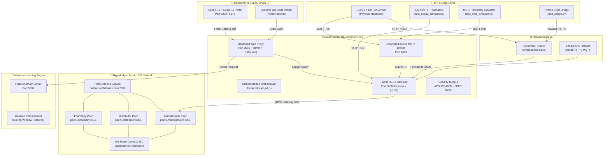

# ColdChainRx

> **A Permissioned Hyperledger Fabric Platform Fusing IoT Telemetry, ML Anomaly Detection, and Dynamic QR Verification for Pharmaceutical Cold Chains.**

[](https://www.hyperledger.org/)
[](https://golang.org/)
[](https://nodejs.org/)
[](https://nextjs.org/)
[](https://scikit-learn.org/)
[](https://www.espressif.com/)
[](#)

---

## 📋 Table of Contents

- [Overview](#-overview)
- [System Architecture](#-system-architecture)
- [Key Features on `swag` Branch](#-key-features-on-swag-branch)
- [Subsystem Ownership](#-subsystem-ownership)
- [Repository Structure](#-repository-structure)
- [Prerequisites](#-prerequisites)
- [Quick Start Guide](#-quick-start-guide)
  - [1. Bootstrap Fabric Blockchain Network](#1-bootstrap-fabric-blockchain-network)
  - [2. Deploy / Upgrade Go Smart Contract](#2-deploy--upgrade-go-smart-contract)
  - [3. Start Backend Services (Unified Orchestrator)](#3-start-backend-services-unified-orchestrator)
  - [4. Start Machine Learning Service](#4-start-machine-learning-service)
  - [5. Launch Consumer Verification Web Portal](#5-launch-consumer-verification-web-portal)
- [IoT Edge & Hardware Setup](#-iot-edge--hardware-setup)
  - [ESP32 Hardware Wiring](#esp32-hardware-wiring)
  - [Cloudflare Zero-Config Tunnel](#cloudflare-zero-config-tunnel)
  - [MQTT Bridge Forwarder](#mqtt-bridge-forwarder)
- [REST API Reference](#-rest-api-reference)
  - [Batch Management](#batch-management)
  - [Device Assignment Registry](#device-assignment-registry)
  - [IoT Telemetry Ingestion](#iot-telemetry-ingestion)
  - [Web Proxy & QR Verification](#web-proxy--qr-verification)
  - [Security & Off-Chain IPFS](#security--off-chain-ipfs)
- [Smart Contract (Chaincode) Reference](#-smart-contract-chaincode-reference)
- [Testing & Simulation Suites](#-testing--simulation-suites)
- [Troubleshooting & FAQs](#-troubleshooting--faqs)

---

## 🚀 Overview

**ColdChainRx** guarantees end-to-end provenance, temperature compliance, and authenticity for critical, temperature-sensitive pharmaceuticals (e.g., mRNA vaccines, biologics, and insulin).

By combining:
1. **Hyperledger Fabric 2.5 Blockchain**: Tamper-proof distributed ledger tracking batch custody, dynamic excursion thresholds, device assignments, and immutable transaction histories.
2. **Autonomous IoT Edge Telemetry**: ESP32 microcontrollers with DHT sensors streaming real-time temperature and humidity readings over HTTP or MQTT.
3. **Machine Learning Anomaly Detection**: Isolation Forest model computing rolling-window anomalies on thermal telemetry.
4. **Consumer Verification Portal**: Next.js 16 / React 19 web interface generating dynamic QR codes for instant verification of batch safety by distributors, pharmacists, and end consumers.

---

## 🏛️ System Architecture



---

## ✨ Key Features on `swag` Branch

### 1. Go Smart Contract (Chaincode v1.1, Sequence 2)
- **Autonomous Device-to-Batch Resolution**: IoT sensor devices bind to pharmaceutical batches (`AssignDeviceToBatch`). Telemetry can be logged directly using `deviceId` without hardcoding batch IDs at the edge. Rogue/unassigned devices are rejected on-chain.
- **Configurable Dynamic Thresholds**: Batches specify custom temperature ranges (`CreateBatchWithThresholds`, `SetBatchThresholds`), supporting both standard cold chain (2°C to 8°C) and ultra-low cryo chain (-80°C to -60°C).
- **Multi-Metric Telemetry**: Simultaneous logging of temperature and relative humidity (`LogTelemetry`). Automatic excursion flag calculation commits instantly to ledger state.
- **Paginated Audit History**: Efficient ledger history queries (`GetBatchHistoryPaginated`) with newest-first ordering to handle long-running shipments without client timeout.
- **Unit Tested**: Full test coverage in `chaincode/coldchainrx/chaincode_test.go`.

### 2. Multi-Organization Fabric Network
- **Consensus**: Raft ordering node (`orderer.coldchainrx.com`).
- **Organizations**: Manufacturer (`ManufacturerMSP`), Distributor (`DistributorMSP`), and Pharmacy (`PharmacyMSP`).
- **Automation Scripts**: Full lifecycle management (`start_network.sh`, `stop_network.sh`, `deploy_chaincode.sh`, `upgrade_chaincode.sh`, `demo_test.sh`, `query_all_history.sh`).

### 3. Backend Gateway & Unified Orchestrator
- **Single-Command Startup**: `node start_all.js` (or `npm start`) checks Fabric Docker containers, boots them if down, kills stale processes on ports 3001 and 5000, and launches all microservices.
- **Embedded Aedes MQTT Broker**: Runs on port 1883, ingesting sensor payloads (`coldchain/telemetry`) and broadcasting excursion alarms (`coldchain/alerts`).
- **Zero-Config Cloudflare Tunnel**: Bundled `bin/cloudflared.exe` opens an instant secure HTTPS tunnel (`npm run tunnel`) for physical ESP32 devices on 4G or external networks.

### 4. Hardened Security & Proxy Gateway
- **Defense in Depth**: Helmet security headers, CORS origin whitelisting, IP-based rate limiting on sensitive endpoints, and regex input sanitization.
- **AES-256-GCM & Off-Chain IPFS**: Authenticated encryption for sensitive patient/shipment metadata with SHA-256 tamper-proof verification (`backend/src/security/`).
- **Graceful Ledger Fallback**: Web proxy seamlessly falls back to mock demo data if the blockchain network is unreachable during presentations.

---

## 👥 Subsystem Ownership

| Team Member | Role & Subsystem Ownership | Key Deliverables on Branch |
| :--- | :--- | :--- |
| **Swagata** | **Blockchain Architecture & Backend Gateway Lead** | Hyperledger Fabric v2.5 multi-org network, Go chaincode (v1.1), Fabric Gateway gRPC REST API (Port 5000), Aedes MQTT Broker (Port 1883), Unified Startup (`start_all.js`), Cloudflare Tunnel integration, Automated deployment and audit scripts |
| **Omkar** | **IoT Edge Hardware & Security Lead** | ESP32 firmware (HTTP & MQTT), DHT11/DHT22 sensor integration, Python MQTT bridge (`mqtt_bridge.py`), threat analysis |
| **Sadique** | **Machine Learning & Frontend Web Portal Lead** | Isolation Forest anomaly detection microservice (Port 5001), Next.js 16 / React 19 consumer QR verification portal |

---

## 📂 Repository Structure

```text
ColdChainRx/
├── backend/                              # Node.js Backend Services & Gateways
│   ├── src/
│   │   ├── controllers/
│   │   │   ├── batchController.js        # Fabric transaction invocations & queries
│   │   │   └── securityController.js     # AES encryption & IPFS off-chain storage
│   │   ├── routes/
│   │   │   └── apiRoutes.js              # REST route definitions
│   │   ├── security/
│   │   │   ├── aesEncryption.js          # AES-256-GCM encryption/decryption
│   │   │   └── ipfsStorage.js            # Simulated IPFS with SHA-256 tamper check
│   │   ├── services/
│   │   │   └── mqttService.js            # Aedes MQTT broker on port 1883
│   │   ├── fabricGateway.js              # @hyperledger/fabric-gateway gRPC client
│   │   └── server.js                     # Fabric REST API server on port 5000
│   ├── server.js                         # Hardened Web Proxy on port 3001 (QR & UI)
│   ├── start_all.js                      # Unified service orchestrator & port cleaner
│   ├── test_esp32_simulator.js           # ESP32 HTTP simulator & device test
│   ├── test_mqtt_simulator.js            # MQTT sensor payload simulator
│   ├── test_security_offchain.js         # Security and cryptographic test suite
│   ├── .env.fabric.example               # Template environment configuration
│   └── package.json                      # Backend dependencies & npm scripts
│
├── bin/                                  # Pre-built Binaries & External Tools
│   ├── cloudflared.exe                   # Cloudflare Tunnel binary for public HTTPS
│   ├── configtxgen                       # Fabric channel generation tool
│   ├── osnadmin                          # Fabric orderer admin CLI
│   └── peer                              # Fabric peer binary
│
├── blockchain/                           # Hyperledger Fabric Network Topology
│   └── network/
│       ├── channel-artifacts/            # Genesis block & channel configuration
│       ├── docker/
│       │   └── docker-compose.yaml       # Fabric Docker containers (Peers, Orderer)
│       ├── organizations/                # Crypto materials & MSP certificates
│       ├── configtx.yaml                 # Fabric channel & profile configurations
│       ├── start_network.sh              # Network bootstrap script
│       ├── stop_network.sh               # Network teardown & cleanup script
│       ├── deploy_chaincode.sh           # Chaincode packaging & deployment script
│       ├── upgrade_chaincode.sh          # Chaincode lifecycle upgrade script
│       ├── query_batch.sh                # Single batch query script
│       ├── query_all_history.sh          # Comprehensive audit script for all batches
│       └── demo_test.sh                  # End-to-end blockchain lifecycle test
│
├── chaincode/                            # Smart Contracts
│   └── coldchainrx/
│       ├── chaincode.go                  # Go smart contract (v1.1 with device registry)
│       ├── chaincode_test.go             # Unit test suite for Go chaincode
│       └── go.mod                        # Go module dependencies
│
├── frontend/                             # Consumer Verification Web Portal
│   ├── app/                              # Next.js App Router (verification & dashboard)
│   ├── components/                       # UI components (QR scanner, telemetry chart)
│   ├── package.json                      # Next.js 16, React 19, Tailwind CSS dependencies
│   └── tsconfig.json
│
├── iot/                                  # IoT Firmware & Edge Integration
│   ├── esp32_coldchainrx_http.ino        # Ready-to-flash ESP32 HTTP sketch (DHT sensor)
│   ├── esp32_coldchainrx_mqtt.ino        # Ready-to-flash ESP32 MQTT sketch
│   ├── mqtt_bridge.py                    # Edge bridge forwarding MQTT to HTTP/Cloudflare
│   └── README.md                         # Detailed hardware pinout & flashing guide
│
├── ml-service/                           # Machine Learning Anomaly Microservice
│   ├── models/
│   │   ├── isolation_forest_model.joblib # Trained Isolation Forest model
│   │   └── scaler.joblib                 # Feature StandardScaler
│   ├── app.py                            # Flask prediction API on port 5001
│   ├── train_anomaly_model.py            # Model training script
│   └── requirements.txt                  # Python dependencies
│
├── cleaned_vaccine_temperature_log.csv   # Historical sensor training dataset
└── README.md                             # Project documentation
```

---

## 💻 Prerequisites

Before running ColdChainRx, ensure your system has the following installed:

| Tool | Version | Purpose |
| :--- | :--- | :--- |
| **Docker & Docker Compose** | 20.10+ / Compose v2+ | Running Hyperledger Fabric peer and orderer containers |
| **Node.js** | v18.0.0 or higher | Backend gateway, MQTT broker, and web proxy |
| **pnpm** or **npm** | pnpm 9+ / npm 9+ | Package management |
| **Go** | 1.20 or higher | Compiling and packaging Go smart contracts |
| **Python** | 3.10 or higher | Running the Flask ML anomaly microservice |
| **Git** & **Bash** | Standard | Executing deployment shell scripts (Git Bash / WSL on Windows) |

---

## 📖 Quick Start Guide

Follow these steps to launch the complete ColdChainRx platform from scratch.

### 1. Bootstrap Fabric Blockchain Network

Open a bash terminal (WSL or Git Bash on Windows):

```bash
cd blockchain/network
chmod +x *.sh

# Bootstrap Raft orderer, 3 peer orgs, and create channel 'coldchainchannel'
./start_network.sh
```

To verify active containers:
```bash
docker ps --format "table {{.Names}}\t{{.Status}}\t{{.Ports}}"
```
You should see:
- `orderer.coldchainrx.com` (Port 7050, Admin 7053)
- `peer0.manufacturer.coldchainrx.com` (Port 7051)
- `peer0.distributor.coldchainrx.com` (Port 8051)
- `peer0.pharmacy.coldchainrx.com` (Port 9451)

### 2. Deploy / Upgrade Go Smart Contract

Deploy the `coldchainrx` chaincode to all peers:

```bash
# In blockchain/network/
./deploy_chaincode.sh
```

Run the end-to-end test script to verify batch creation and queries directly on the ledger:
```bash
./demo_test.sh
```

### 3. Start Backend Services (Unified Orchestrator)

In a new terminal, navigate to `backend/` and start all backend services:

```bash
cd backend
npm install
npm start
```

> **What `npm start` does automatically:**
> 1. Verifies that Fabric Docker containers are healthy.
> 2. Auto-terminates any stale processes occupying ports `5000` or `3001` (prevents `EADDRINUSE` errors).
> 3. Launches **Fabric Gateway & REST API** on `http://localhost:5000`.
> 4. Launches **Embedded Aedes MQTT Broker** on `mqtt://localhost:1883`.
> 5. Launches **Hardened Web Proxy** on `http://localhost:3001`.

### 4. Start Machine Learning Service

In a new terminal, set up and run the Python Flask anomaly detection microservice:

```bash
cd ml-service

# Create and activate virtual environment
python -m venv venv

# Windows (PowerShell)
.\venv\Scripts\Activate.ps1
# Linux / macOS / Git Bash
source venv/bin/activate

# Install dependencies and start Flask server on port 5001
pip install -r requirements.txt
python app.py
```
The ML server will start on **`http://localhost:5001`**.

### 5. Launch Consumer Verification Web Portal

In a new terminal, launch the Next.js frontend:

```bash
cd frontend
pnpm install   # or npm install
pnpm dev       # or npm run dev
```
Open **`http://localhost:3000`** in your browser.

---

## 📡 IoT Edge & Hardware Setup

### ESP32 Hardware Wiring

Connect the **DHT11** or **DHT22** sensor to the ESP32 board:

| DHT Sensor Pin | ESP32 Pin | Description |
| :--- | :--- | :--- |
| **VCC** | **3V3** or **VIN** | 3.3V or 5V Power Supply |
| **GND** | **GND** | Ground |
| **DATA** | **GPIO 4** | Sensor Data Line |
| **Status LED** | **GPIO 2** | Built-in Blue LED (flashes on telemetry transmit) |

### Option A: Flash ESP32 via HTTP (Recommended)
1. Open [`iot/esp32_coldchainrx_http.ino`](file:///c:/Users/Swagata%20Paul/Desktop/Projects/ColdChainRx/iot/esp32_coldchainrx_http.ino) in Arduino IDE.
2. Install the **DHT sensor library** (by Adafruit) from *Library Manager*.
3. Enter your Wi-Fi credentials:
   ```cpp
   const char* WIFI_SSID     = "Your_WiFi_SSID";
   const char* WIFI_PASSWORD = "Your_WiFi_Password";
   ```
4. Flash the ESP32 and open Serial Monitor at **115200 baud**.

### Option B: Cloudflare Zero-Config Tunnel (For Remote ESP32 / 4G Hotspots)
If your ESP32 is running on a mobile hotspot or an external network outside your home Wi-Fi:

```bash
cd backend
npm run tunnel
```
This launches `bin/cloudflared.exe` and outputs a public URL (e.g., `https://your-tunnel-subdomain.trycloudflare.com`). Update the `SERVER_URL` in `esp32_coldchainrx_http.ino` to point directly to the tunnel endpoint:
```cpp
const char* SERVER_URL = "https://your-tunnel-subdomain.trycloudflare.com/api/iot/temperature";
```

### Option C: MQTT Bridge Forwarder
If your ESP32 publishes to a local Mosquitto broker:
```bash
pip install paho-mqtt requests
python iot/mqtt_bridge.py
```
This bridges local MQTT packets directly to the Cloudflare / local REST gateway over HTTPS.

---

## 🧪 REST API Reference

### Batch Management

#### 1. Create a Pharmaceutical Batch
- **Method / URL**: `POST http://localhost:5000/api/batch/create`
- **Headers**: `Content-Type: application/json`
- **Request Body**:
  ```json
  {
    "id": "BATCH_COVID_2026_01",
    "drugName": "COVID-19 mRNA Vaccine",
    "manufacturer": "Pfizer-BioNTech",
    "minTemp": 2.0,
    "maxTemp": 8.0
  }
  ```
- **Response (`201 Created`)**:
  ```json
  {
    "success": true,
    "message": "Batch BATCH_COVID_2026_01 successfully created on blockchain.",
    "data": {
      "id": "BATCH_COVID_2026_01",
      "drugName": "COVID-19 mRNA Vaccine",
      "manufacturer": "Pfizer-BioNTech",
      "status": "Manufactured",
      "minTemp": 2.0,
      "maxTemp": 8.0
    }
  }
  ```

#### 2. Query Batch Current State
- **Method / URL**: `GET http://localhost:5000/api/batch/:id`
- **Example**: `GET http://localhost:5000/api/batch/BATCH_COVID_2026_01`
- **Response (`200 OK`)**:
  ```json
  {
    "success": true,
    "data": {
      "id": "BATCH_COVID_2026_01",
      "drugName": "COVID-19 mRNA Vaccine",
      "manufacturer": "Pfizer-BioNTech",
      "currentOwner": "Pfizer-BioNTech",
      "status": "Manufactured",
      "minTemp": 2.0,
      "maxTemp": 8.0,
      "assignedDevice": "BOX_SENSOR_A1",
      "excursionAlert": false,
      "temperatureLogs": [
        {
          "timestamp": "2026-11-12T12:00:00Z",
          "temperature": 4.5,
          "humidity": 55.2,
          "reporter": "BOX_SENSOR_A1"
        }
      ]
    }
  }
  ```

#### 3. Transfer Custody
- **Method / URL**: `POST http://localhost:5000/api/batch/transfer`
- **Request Body**:
  ```json
  {
    "id": "BATCH_COVID_2026_01",
    "newOwner": "DHL Cold Chain Logistics",
    "newStatus": "InTransit"
  }
  ```

#### 4. Query Batch History (Paginated)
- **Method / URL**: `GET http://localhost:5000/api/batch/:id/history?page=1&pageSize=10`
- **Response (`200 OK`)**:
  ```json
  {
    "success": true,
    "totalRecords": 15,
    "pagination": {
      "totalRecords": 15,
      "page": 1,
      "pageSize": 10,
      "totalPages": 2,
      "hasMore": true
    },
    "data": [ ... ]
  }
  ```

---

### Device Assignment Registry

#### 1. Assign IoT Sensor Box to Batch
- **Method / URL**: `POST http://localhost:5000/api/device/assign`
- **Request Body**:
  ```json
  {
    "deviceId": "BOX_SENSOR_A1",
    "batchId": "BATCH_COVID_2026_01"
  }
  ```

#### 2. Query Current Assignment of Device
- **Method / URL**: `GET http://localhost:5000/api/device/:deviceId/batch`
- **Example**: `GET http://localhost:5000/api/device/BOX_SENSOR_A1/batch`

#### 3. Unassign Device
- **Method / URL**: `POST http://localhost:5000/api/device/unassign`
- **Request Body**:
  ```json
  {
    "deviceId": "BOX_SENSOR_A1"
  }
  ```

---

### IoT Telemetry Ingestion

#### Autonomous Telemetry Ingestion (with Dynamic Device Resolution)
- **Method / URL**: `POST http://localhost:5000/api/iot/temperature`
- **Request Body (from ESP32 or Simulator)**:
  ```json
  {
    "sensor_id": "BOX_SENSOR_A1",
    "temperature": 4.5,
    "humidity": 55.0,
    "timestamp": "2026-11-12T13:30:00Z"
  }
  ```
  > **Note**: The backend automatically resolves `sensor_id` to its assigned batch on the ledger. If `BOX_SENSOR_A1` is not assigned to an active batch, the request is rejected with `HTTP 400 Bad Request` to prevent unauthorized ledger writes.

---

### Web Proxy & QR Verification

#### Verify Batch & Generate Dynamic QR Code
- **Method / URL**: `GET http://localhost:3001/api/fabric/batch/:id`
- **Example**: `GET http://localhost:3001/api/fabric/batch/BATCH_COVID_2026_01`
- **Response (`200 OK`)**:
  ```json
  {
    "success": true,
    "data": {
      "batchId": "BATCH_COVID_2026_01",
      "drugName": "COVID-19 mRNA Vaccine",
      "status": "Authentic & Safe (InTransit)",
      "storageType": "Cold Storage (2°C – 8°C)",
      "excursionAlert": false,
      "readings": [ ... ],
      "_live": true
    },
    "qrCode": "data:image/png;base64,iVBORw0KGgoAAAANSUhEUgAA..."
  }
  ```

#### Predict ML Anomaly
- **Method / URL**: `POST http://localhost:3001/api/batches/:batchId/anomaly`
- **Request Body**:
  ```json
  {
    "temperature": 11.5,
    "humidity": 65.0,
    "sensor_id": "BOX_SENSOR_A1"
  }
  ```

---

### Security & Off-Chain IPFS

| Endpoint | Method | Description |
| :--- | :--- | :--- |
| `/api/security/encrypt` | `POST` | Encrypt sensitive payload using AES-256-GCM |
| `/api/security/decrypt` | `POST` | Decrypt and verify payload using master key |
| `/api/security/offchain/upload` | `POST` | Store large payload in off-chain store; returns CID |
| `/api/security/offchain/:cid` | `GET` | Retrieve off-chain JSON object by CID |
| `/api/security/offchain/verify` | `POST` | Verify payload against CID using SHA-256 hash |

---

## 📜 Smart Contract (Chaincode) Reference

The Go smart contract is located at [`chaincode/coldchainrx/chaincode.go`](file:///c:/Users/Swagata%20Paul/Desktop/Projects/ColdChainRx/chaincode/coldchainrx/chaincode.go):

| Chaincode Function | Arguments | Description |
| :--- | :--- | :--- |
| `CreateBatch` | `id, drugName, manufacturer` | Creates batch with standard default thresholds (2.0°C – 8.0°C). |
| `CreateBatchWithThresholds` | `id, drugName, manufacturer, minTemp, maxTemp` | Creates batch with custom temperature thresholds. |
| `SetBatchThresholds` | `id, minTemp, maxTemp` | Updates temperature bounds for a batch. |
| `AssignDeviceToBatch` | `deviceId, batchId, timestamp` | Binds an IoT sensor box to a specific batch. |
| `GetDeviceAssignment` | `deviceId` | Queries the active batch mapped to a device. |
| `UnassignDevice` | `deviceId` | Releases device binding after delivery. |
| `LogTelemetry` | `batchId, timestamp, temp, hum, reporter` | Appends temperature & humidity reading. Triggers `ExcursionAlert = true` if outside thresholds. |
| `LogDeviceTelemetry` | `deviceId, timestamp, temp, hum` | Resolves device to batch and commits telemetry in a single step. |
| `TransferCustody` | `id, newOwner, newStatus` | Updates custody and status (e.g., Manufacturer ➡️ Distributor). |
| `QueryBatch` | `id` | Returns current ledger state for a batch. |
| `GetBatchHistory` | `id` | Returns all transaction modifications for an asset. |
| `GetBatchHistoryPaginated` | `id, pageSize, pageNum` | Returns paginated transaction audit history. |

---

## 🧪 Testing & Simulation Suites

### 1. Simulated ESP32 Telemetry Test
Simulates an ESP32 device, creates a new batch, assigns the device, logs normal readings, and triggers a deliberate temperature excursion:
```bash
cd backend
npm run test:esp32
```

### 2. MQTT Telemetry Test
Publishes live sensor readings directly to the embedded Aedes MQTT broker on port 1883:
```bash
cd backend
npm run test:mqtt
```

### 3. Cryptography & Off-Chain IPFS Security Test
Tests AES-256-GCM authenticated encryption, tampering detection, and SHA-256 IPFS off-chain storage:
```bash
cd backend
npm run test:security
```

### 4. Fabric Ledger Multi-Batch Audit Script
Queries all demo batches and prints their full transaction block history directly from peer containers:
```bash
cd blockchain/network
./query_all_history.sh
```

---

## ❓ Troubleshooting & FAQs

### Port `3001` or `5000` is already in use (`EADDRINUSE`)
- `backend/start_all.js` automatically terminates lingering Node processes on ports 3001 and 5000 upon launch.
- To manually free ports on Windows PowerShell:
  ```powershell
  Get-NetTCPConnection -LocalPort 3001,5000 -ErrorAction SilentlyContinue | ForEach-Object { Stop-Process -Id $_.OwningProcess -Force }
  ```

### Docker Containers Not Detected by Gateway
- Ensure Docker Desktop is running.
- Start containers manually:
  ```bash
  cd blockchain/network
  docker-compose -f docker/docker-compose.yaml up -d
  ```

### Python Virtual Environment Execution Policy (Windows)
If PowerShell blocks activating `venv\Scripts\Activate.ps1`:
```powershell
Set-ExecutionPolicy -ExecutionPolicy RemoteSigned -Scope Process
```

### Chaincode Re-deployment / Upgrade
If you modify `chaincode/coldchainrx/chaincode.go`:
```bash
cd blockchain/network
./deploy_chaincode.sh
```
The script auto-detects the committed sequence on the channel and increments the definition to deploy the updated version seamlessly.

---

## 📄 License & Attribution

Developed as part of the **ColdChainRx** project for secure pharmaceutical supply chains. Built with [Hyperledger Fabric](https://www.hyperledger.org/), [Express](https://expressjs.com/), [Next.js](https://nextjs.org/), and [Scikit-Learn](https://scikit-learn.org/).
